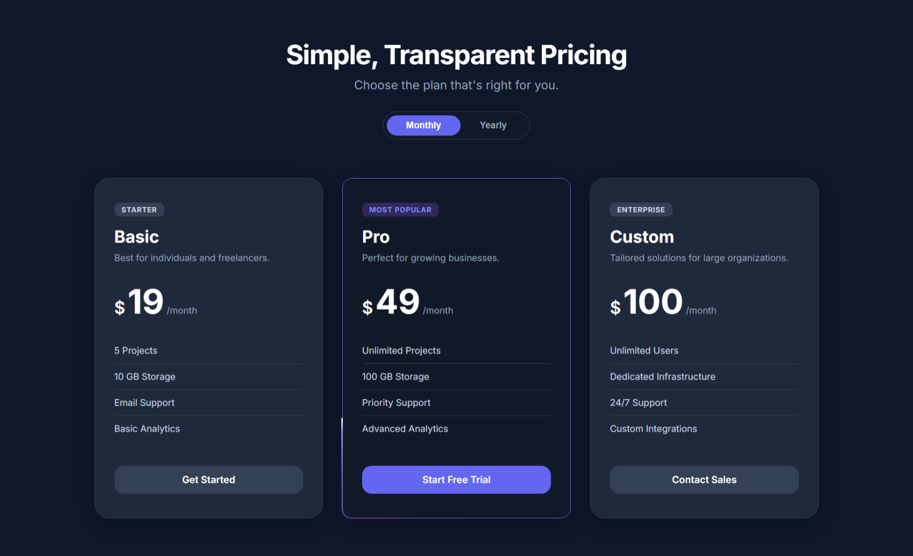

# 02. Pricing Cards Section

## Status: ✅ Completed

## Features

- Basic, Pro, and Custom plans
- Feature lists for every plan
- Call-to-action buttons
- Highlighted "Most Popular" plan with an animated glowing light that travels around its border
- Monthly / Yearly billing toggle that updates prices and duration labels
- Hover effects and smooth transitions
- Responsive grid layout for desktop, tablet, and mobile
- Dark theme with a consistent color palette

## Skills Practiced

- CSS Grid and Flexbox
- Card Layouts
- Visual Hierarchy
- CSS Variables
- Conic Gradients and Masking
- `@property` and Keyframe Animations
- Hover and Focus States
- Media Queries
- CSS Transitions
- DOM Manipulation with JavaScript (event delegation, data attributes)
- Responsive Web Design

## Technologies Used

- HTML5
- CSS3
- JavaScript (Vanilla)

## Learning Outcomes

- Practiced building reusable UI components.
- Learned to animate a border using a conic gradient and a registered custom property.
- Used data attributes and event delegation to switch pricing plans.
- Improved visual hierarchy to emphasize the featured plan.
- Practiced hover interactions and responsive styling.
