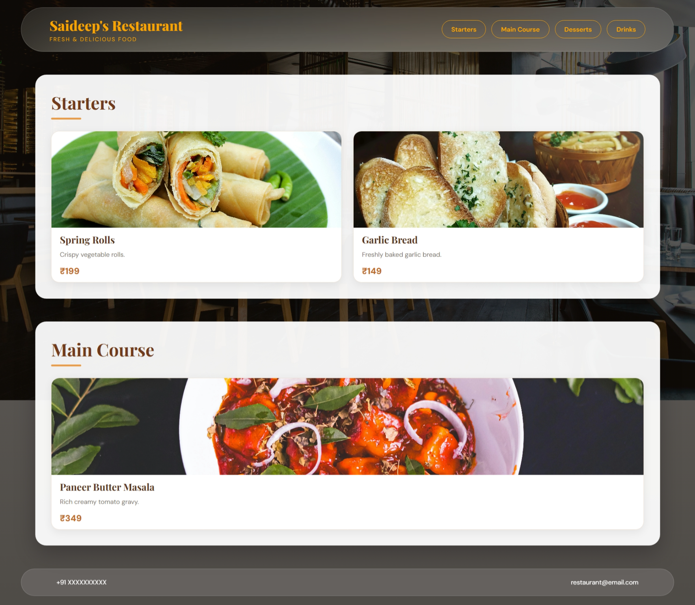

# 03. Restaurant Menu Page

## Status: ✅ Completed

## Features

- Restaurant header with brand name and tagline
- Navigation links for different menu categories
- Menu categories including Starters and Main Course
- Food cards with images, descriptions, and pricing information
- Attractive glassmorphism header and footer
- Modern dark theme with warm golden accents
- Hover effects and smooth transitions on food cards
- Responsive menu grid layout for desktop, tablet, and mobile
- Elegant typography and consistent color palette
- Background image with a dark overlay for better readability

## Skills Practiced

- CSS Grid and Flexbox
- Card Layouts
- Responsive Web Design
- Typography and Visual Hierarchy
- Glassmorphism Effects
- Background Images and Overlays
- Hover Effects and CSS Transitions
- Media Queries
- HTML Semantic Elements
- Navigation and Anchor Links

## Technologies Used

- HTML5
- CSS3

## Learning Outcomes

- Practiced designing a restaurant menu using reusable food card components.
- Learned to organize menu categories using semantic HTML sections.
- Improved understanding of CSS Grid and Flexbox for responsive layouts.
- Practiced creating modern UI designs using glassmorphism and backdrop filters.
- Learned to enhance user experience with hover effects and smooth transitions.
- Improved typography, spacing, and visual hierarchy.
- Practiced building responsive layouts for desktop, tablet, and mobile devices.

---
