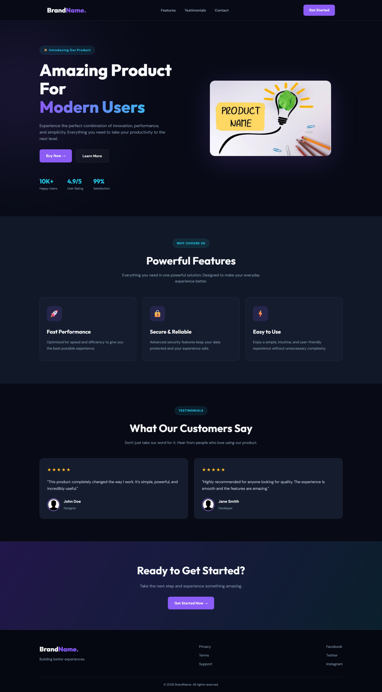

### 4. Product Landing Page

## Status: ✅ Completed

## Features

- Modern navigation bar with brand logo and menu links
- Hero section with product image and call-to-action buttons
- Features section highlighting key product benefits
- Customer testimonials with profile images and ratings
- Call-to-action section to encourage user engagement
- Footer with brand information and social media links
- Modern dark theme with purple and cyan gradient accents
- Hover effects and smooth CSS transitions
- Responsive layout for desktop, tablet, and mobile devices
- Consistent typography and color palette

## Skills Practiced

- HTML5 Semantic Structure
- CSS Grid and Flexbox
- Responsive Web Design
- Typography and Visual Hierarchy
- CSS Variables
- Background Gradients
- Card Layouts
- Hover Effects and CSS Transitions
- Media Queries
- Navigation Design
- Section Layout and Spacing

## Technologies Used

- HTML5
- CSS3

## Learning Outcomes

- Practiced building a complete product landing page using semantic HTML.
- Learned to structure multiple website sections with reusable CSS classes.
- Improved understanding of CSS Grid and Flexbox for responsive layouts.
- Practiced creating modern designs using gradients and dark themes.
- Learned to improve user experience with hover effects and smooth transitions.
- Developed skills in designing hero sections, feature cards, and testimonials.
- Improved responsive design techniques for different screen sizes.

---
