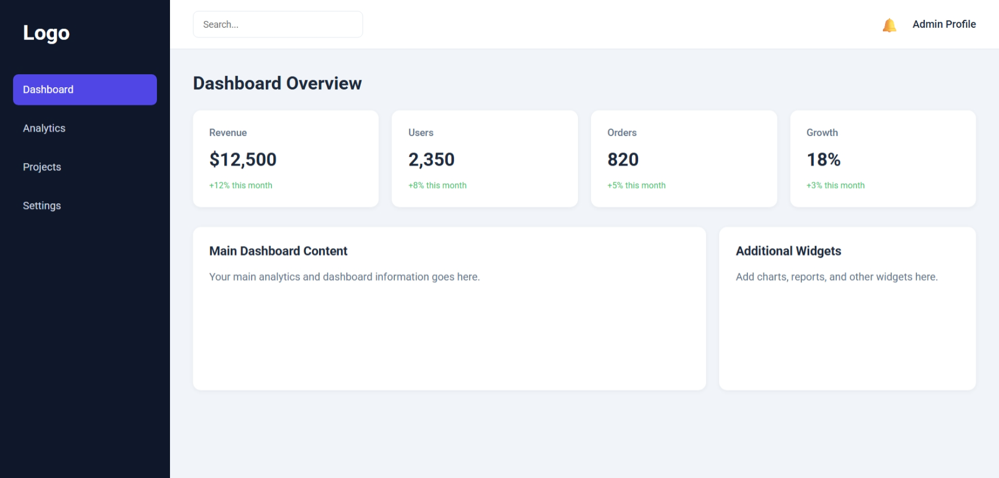

### 5. Dashboard Layout

**Status:** 🟨 In Progress

#### Features

- [x] Sidebar navigation
- [x] Top navigation bar
- [x] Statistics cards (Revenue, Users, Orders, Growth)
- [x] Main content area
- [x] Additional widgets section
- [x] Search bar
- [x] Profile and notification section
- [x] Sidebar hover and active states
- [x] Card styling with shadows and rounded corners
- [x] Responsive layout for desktop, tablet, and mobile

#### Skills Practiced

- [x] HTML5 Semantic Elements
- [x] CSS Variables
- [x] CSS Flexbox
- [x] CSS Grid
- [x] Complex Layouts
- [x] Positioning and Alignment
- [x] Responsive Design
- [x] Media Queries
- [x] Dashboard UI Patterns
- [x] Hover Effects and Transitions

#### Future Improvements

- [ ] Add revenue charts using Chart.js
- [ ] Add recent orders table
- [ ] Implement collapsible sidebar
- [ ] Add functional search
- [ ] Add profile dropdown
- [ ] Add dark mode
- [ ] Improve accessibility

#### Project Preview

**Learning Outcome:** Built a responsive admin dashboard using HTML5, CSS Flexbox, and CSS Grid, with reusable components, responsive layouts, and modern UI styling.
