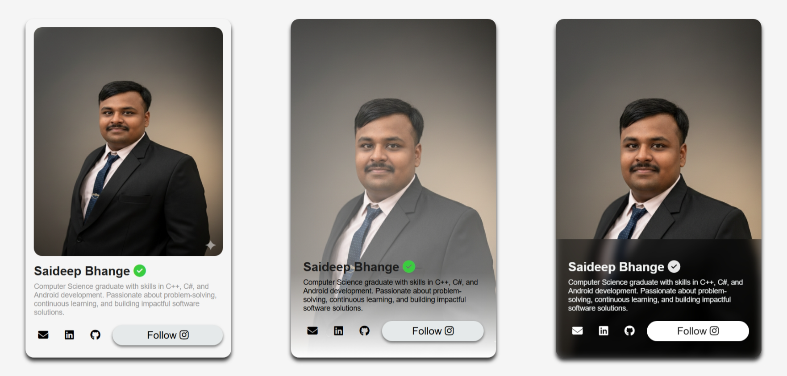
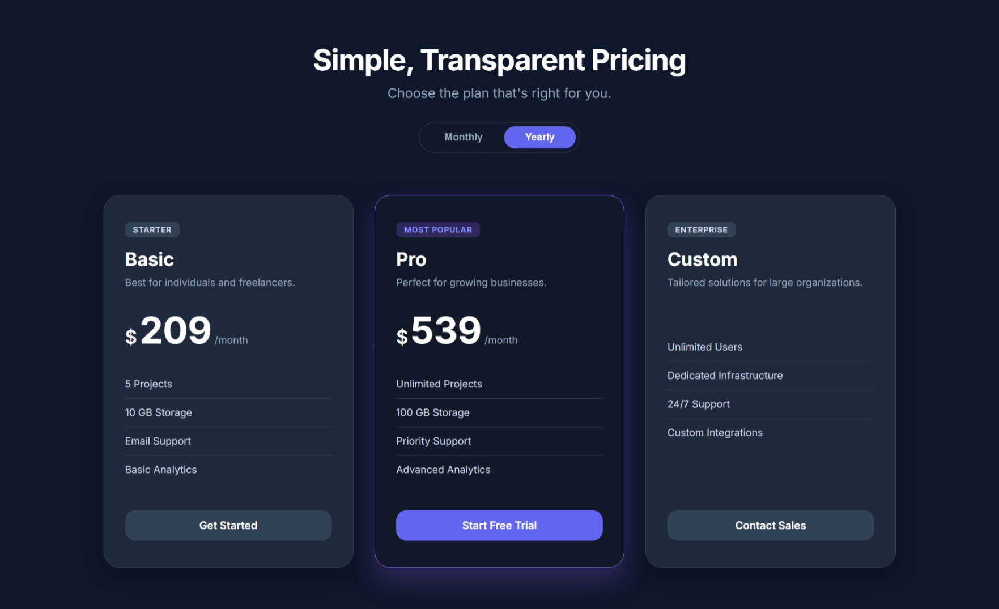
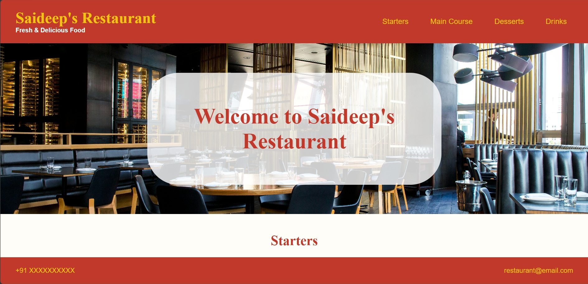
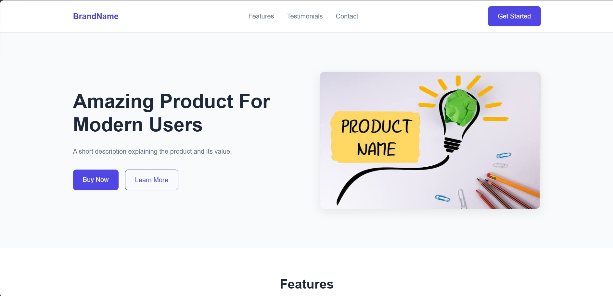
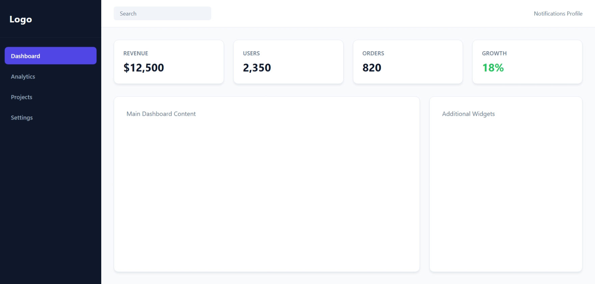

# CSS Learning Projects

This repository contains small CSS projects I'm building while learning frontend development. The goal is to strengthen my understanding of CSS through hands-on practice rather than only following tutorials.

## Learning Goals

- Improve CSS fundamentals
- Practice Flexbox and CSS Grid
- Learn responsive design
- Build confidence creating layouts from scratch
- Develop a portfolio of beginner-friendly projects

---

## Project Roadmap

### 1. Personal Profile Card

**Status:** ✅ Completed

#### Features

- Profile image
- Name and title
- Short bio
- Social media links
- Hover effects

#### Skills Practiced

- Box Model
- Spacing and Alignment
- Border Radius
- Shadows
- Flexbox
- Hover States
  

---

### 2. Pricing Cards Section

**Status:** ✅ Completed

#### Features

- Basic, Pro, and Premium plans
- Feature lists
- Call-to-action buttons
- Highlighted "Most Popular" plan

#### Skills Practiced

- Flexbox
- Card Layouts
- Visual Hierarchy
- CSS Transitions
- Hover Effects
  

---

### 3. Restaurant Menu Page

**Status:** ✅ Completed

#### Features

- Menu categories
- Food cards
- Pricing information
- Responsive layout

#### Skills Practiced

- CSS Grid
- Layout Design
- Responsive Design
- Typography
- Cards
  

---

### 4. Product Landing Page

**Status:** ✅ Completed

#### Features

- Hero section
- Features section
- Testimonials
- Footer
- Navigation bar

#### Skills Practiced

- Responsive Layouts
- Background Images
- Typography
- Flexbox
- Section Design
  

---

### 5. Dashboard Layout

**Status:** ⬜ Not Started

#### Features

- Sidebar
- Top navigation
- Statistics cards
- Main content area

#### Skills Practiced

- CSS Grid
- Complex Layouts
- Positioning
- Responsive Design
- Dashboard UI Patterns

---

## Progress Tracker

| Project               | Status |
| --------------------- | ------ |
| Personal Profile Card | ✅     |
| Pricing Cards Section | ✅     |
| Restaurant Menu Page  | ✅     |
| Product Landing Page  | ✅     |
| Dashboard Layout      | ✅     |

### Legend

- ⬜ Not Started
- 🟨 In Progress
- ✅ Completed

---

## Notes

This repository is part of my CSS learning journey. Each project is intentionally small and focused on helping me understand specific CSS concepts through practice.

### Current Focus

- [x] Flexbox
- [x] CSS Grid
- [x] Responsive Design
- [x] Transitions & Animations
- [x] Layout Building

---

## Completion Goal

Complete all five projects without copying the final code from tutorials and rely primarily on documentation, experimentation, and problem-solving.

### Project Links

- [Profile Card](./profile-card)
- [Pricing Cards](./pricing-cards)
- [Restaurant Menu](./restaurant-menu)
- [Product Landing Page](./product-landing-page)
- [Dashboard Layout](./dashboard-layout)
